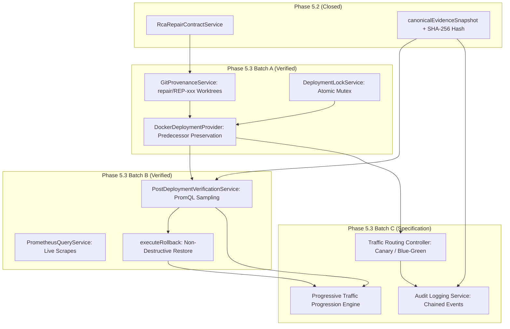
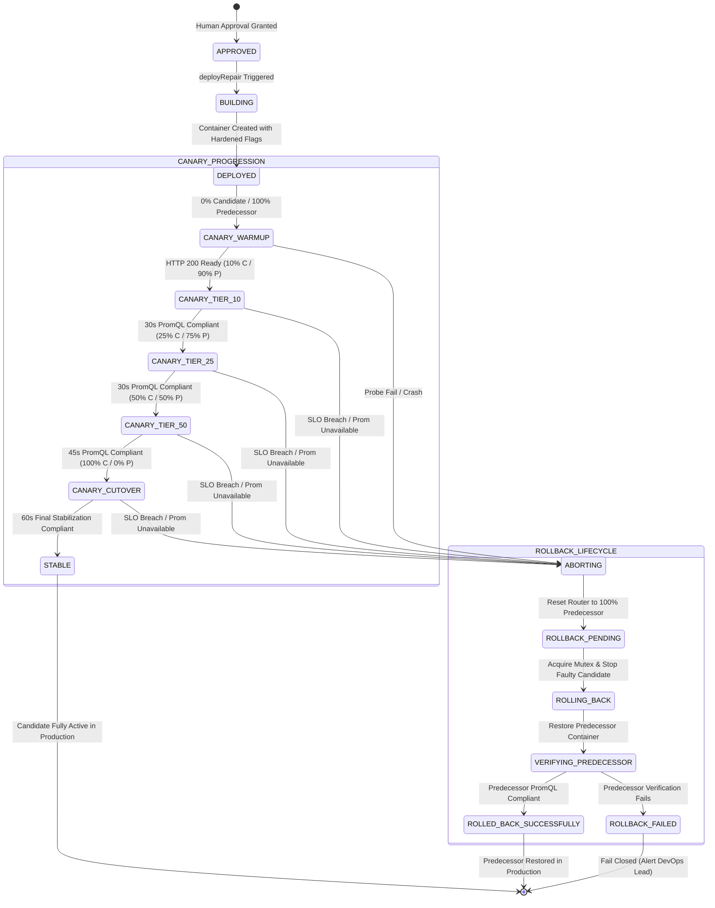

# Phase 5.3 Batch C — Formal Engineering Specification: Progressive Traffic Shifting & Audit Logging

**Document Status:** FORMAL SPECIFICATION DESIGN (READ-ONLY)  
**Date:** 2026-10-02  
**Target Subsystem:** TraceOps AI DevOps Platform — Post-Deployment Traffic Controller & Audit Subsystem  
**Scope Classification:** Phase 5.3 Batch C ONLY  
**Baseline Verified State:**
- Phase 5.1 Security Hardening: **VERIFIED** (`test_phase5_1_security_hardening.js` — 41/41 Passed)
- Phase 5.2 RCA → Repair Contract: **CLOSED & VERIFIED** (Commit `d5bb18a` / `b32a5e1`, 62/62 Passed)
- Phase 5.3 Batch A Deployment Foundation: **VERIFIED** (Commit `7e421f9` / `99da22b`, 61/61 Passed)
- Phase 5.3 Batch B Prometheus Verification & Rollback: **VERIFIED** (Commit `f1176b5` / `3a5651d`, 53/53 Passed)

---

## 1. Purpose and Scope

### 1.1 What Batch C Adds
Phase 5.3 Batch C introduces **controlled multi-stage progressive traffic shifting** and **cryptographically chained deployment audit logging** on top of the verified Phase 5.3 Batch B deployment and rollback infrastructure.

Specifically, Batch C specifies:
1. **Cryptographically Chained Audit Logging:** A tamper-evident append-only audit event stream (`DeploymentAuditEvent`) that records every deployment action, human approval, traffic transition, Prometheus verification sample, and rollback invocation, anchoring each event to the Phase 5.2 immutable evidence snapshot (`evidenceSnapshotHash`).
2. **Progressive Traffic Routing:** A traffic routing interface that splits live incoming requests between the verified **Predecessor** container and the new **Candidate** container.
3. **Dual Deployment Strategies:**
   - **Canary Deployment:** Progressive incremental shifting across defined weight tiers (`0%` → `10%` → `25%` → `50%` → `100%`) with mandatory Prometheus SLO verification at every tier.
   - **Blue-Green Deployment:** Independent candidate warm-up (`0%`), followed by atomic cutover (`100%`) upon Prometheus compliance verification, with instant one-step revert capability.
4. **Automated Zero-Touch Abort & Rollback Integration:** Direct integration with the verified Phase 5.3 Batch B automated rollback engine (`PostDeploymentVerificationService.executeRollback`). If any progressive tier experiences an SLO breach, telemetry loss, or container failure, traffic routing immediately resets to 100% predecessor, candidate container is isolated, and predecessor health is re-verified in Prometheus.

### 1.2 What Batch C Explicitly Does NOT Add (Non-Goals)
Batch C strictly enforces the following architectural boundaries:
- **NO ML Model Promotion:** Machine learning models are **NOT** promoted, retrained, calibrated, or updated in Batch C. Active production model `2.0.0` remains unchanged; candidate `3.1.0` remains unpromoted.
- **NO Autonomous Model Governance:** Automatically updating models based on post-repair telemetry is deferred to **Phase 5.3 Batch D**.
- **NO Host Execution:** All container interactions continue to execute strictly through isolated Docker commands (`execFileAsync("docker", ...)`); zero host node/npm command fallbacks.
- **NO Sandbox Weakening:** Containers continue to enforce `--cap-drop=ALL`, `--security-opt=no-new-privileges`, `--memory 512m`, `--cpus 1.0`, and `--pids-limit 128`.
- **NO Approval Gate Bypass:** Every candidate repair must possess `approvalStatus === "APPROVED"` and `validationStatus === "VALIDATED"` prior to canary initiation.

---

## 2. Baseline Dependencies

Batch C builds directly upon existing, verified repository components without re-implementing or weakening any preceding phase:



### Exact Consumed Interfaces
1. **From Phase 5.2:**
   - Model: [`CodeRepair`](file:///c:/Users/Vikas/Desktop/requirement-traceable-devops/backend/src/models/CodeRepair.ts) (`incidentId`, `rcaId`, `sloId`, `requirementId`, `evidenceSnapshotHash`, `canonicalEvidenceSnapshot`, `approvalStatus`, `validationStatus`).
   - Service: [`RcaRepairContractService.canonicalStringify`](file:///c:/Users/Vikas/Desktop/requirement-traceable-devops/backend/src/services/rcaRepairContractService.ts#L45) for deterministic evidence hashing.
2. **From Phase 5.3 Batch A:**
   - Model: [`DeploymentLock`](file:///c:/Users/Vikas/Desktop/requirement-traceable-devops/backend/src/models/DeploymentLock.ts) (`service`, `repairId`, `ownerToken`, `status: "HELD"`).
   - Service: [`DeploymentLockService.acquireLock`](file:///c:/Users/Vikas/Desktop/requirement-traceable-devops/backend/src/services/deploymentLockService.ts#L36) and `releaseLock` (prevents concurrent deployment or traffic manipulation conflicts).
   - Service: [`GitProvenanceService.commitCandidate`](file:///c:/Users/Vikas/Desktop/requirement-traceable-devops/backend/src/services/gitProvenanceService.ts#L152) (anchors candidate container to immutable commit SHA).
   - Predecessor Preservation: `Deployment.predecessorImage` and `Deployment.predecessorContainer` are guaranteed to exist and remain intact.
3. **From Phase 5.3 Batch B:**
   - Model: [`DeploymentVerification`](file:///c:/Users/Vikas/Desktop/requirement-traceable-devops/backend/src/models/DeploymentVerification.ts) (stores PromQL query string, samples, actual values, and verification outcome).
   - Model: [`Deployment`](file:///c:/Users/Vikas/Desktop/requirement-traceable-devops/backend/src/models/Deployment.ts) (rollback fields: `rollbackStatus`, `rollbackVerificationStatus`, `rollbackStartedAt`, `rollbackCompletedAt`, `rollbackReason`, `rollbackTelemetryEvidence`).
   - Service: [`PostDeploymentVerificationService.verifyDeployment`](file:///c:/Users/Vikas/Desktop/requirement-traceable-devops/backend/src/services/postDeploymentVerificationService.ts#L106) (executes PromQL sampling over observation windows).
   - Service: [`PostDeploymentVerificationService.executeRollback`](file:///c:/Users/Vikas/Desktop/requirement-traceable-devops/backend/src/services/postDeploymentVerificationService.ts#L294) (restores predecessor container and verifies health via Prometheus).
   - Service: [`PrometheusQueryService.queryInstant`](file:///c:/Users/Vikas/Desktop/requirement-traceable-devops/backend/src/services/prometheusQueryService.ts#L59) (evaluates PromQL expressions against live Prometheus).

---

## 3. Exact Batch C Objectives

Batch C must fulfill five measurable engineering objectives:

1. **Objective C-1: Multi-Tier Traffic Splitting**
   - Provide an active software traffic router capable of directing requests between Predecessor and Candidate containers with integer percentage granularity ($0\% \le w \le 100\%$, where $w_{\text{cand}} + w_{\text{pred}} = 100\%$).
2. **Objective C-2: Dual Strategy State Machines**
   - Support both **Canary** (multi-step progressive advancement) and **Blue-Green** (single-step atomic flip) deployment modes, selectable upon deployment initialization.
3. **Objective C-3: Automated Multi-Stage Prometheus Gating**
   - No traffic progression may advance to the next tier without observing genuine Prometheus PromQL samples satisfying the linked SLO ($v_{\text{measured}} \le \text{threshold}$) throughout the entire stabilization window of the current tier.
4. **Objective C-4: Fail-Closed Zero-Downtime Abort**
   - Upon encountering any SLO violation, missing telemetry, or container crash during traffic ramp, the system must immediately restore $100\%$ traffic to the predecessor container within $< 500\text{ms}$ and invoke Batch B rollback.
5. **Objective C-5: Immutable Chained Audit Trail**
   - Every traffic shift, verification outcome, human authorization, and abort event must be recorded in an append-only audit model (`DeploymentAuditEvent`), cryptographically chained via SHA-256 parent hashes (`previousEventHash` $\to$ `eventHash`).

---

## 4. Traffic Model

### 4.1 Role Definitions
- **Predecessor Container ($P$):** The verified, previously running container image serving stable production traffic (recorded in `Deployment.predecessorContainer` and `Deployment.predecessorImage`).
- **Candidate Container ($C$):** The new container image compiled from the Git candidate commit (`repair.candidateCommitSha`) with Phase 5.1 security hardening flags (recorded in `Deployment.candidateContainer` and `Deployment.candidateImage`).
- **Active Traffic Router ($R$):** The routing proxy routing incoming service traffic to port $P_{\text{port}}$ or $C_{\text{port}}$ according to the current weight distribution $(w_C, w_P)$.

### 4.2 Traffic Weights & Allowed Values
- Constraints: $w_C \in [0, 100]$, $w_P \in [0, 100]$, and $w_C + w_P = 100$.

### 4.3 Proposed Progressive Progression Sequence (Canary Strategy)

| Stage | Name | Candidate % ($w_C$) | Predecessor % ($w_P$) | Observation Window | Min. Prom Samples | Required State | Abort / Rollback Condition |
| :---: | :--- | :---: | :---: | :---: | :---: | :--- | :--- |
| **0** | Warmup & Readiness | $0\%$ | $100\%$ | $10\text{s}$ | 3 probes | Container Running, HTTP 200 on port | Readiness probe failure or container crash |
| **1** | Canary Inception | $10\%$ | $90\%$ | $30\text{s}$ | 6 samples (every 5s) | `CANARY_EVALUATING_10` | SLO breached, Prometheus down, 0 samples |
| **2** | Canary Expansion | $25\%$ | $75\%$ | $30\text{s}$ | 6 samples (every 5s) | `CANARY_EVALUATING_25` | SLO breached, Prometheus down, error rate spike |
| **3** | Majority Shift | $50\%$ | $50\%$ | $45\text{s}$ | 9 samples (every 5s) | `CANARY_EVALUATING_50` | SLO breached, Prometheus down, latency degradation |
| **4** | Full Cutover | $100\%$ | $0\%$ | $60\text{s}$ | 12 samples (every 5s) | `CANARY_PROMOTED` / `STABLE` | SLO breached during final stabilization window |

*Note on Value Status:* All stage percentages, durations, and sample counts above are **PROPOSED SPECIFICATION VALUES** designed to balance real-world verification fidelity with automated test execution efficiency.

---

## 5. Canary vs. Blue-Green Strategies

Batch C supports **both** Canary and Blue-Green strategies via an explicit configuration parameter: `trafficStrategy: "CANARY" | "BLUE_GREEN"`.

### 5.1 Canary Strategy State Machine
```text
[APPROVED] 
    │
    ▼ (deployRepair)
[DEPLOYED] 
    │
    ▼ (Start Canary)
[CANARY_WARMUP (0% C / 100% P)] ──(Probe Fail)──> [ABORTING] ──> [ROLLBACK_PENDING]
    │ (Readiness HTTP 200 OK)
    ▼
[CANARY_TIER_10 (10% C / 90% P)] ──(SLO Breach)─> [ABORTING] ──> [ROLLBACK_PENDING]
    │ (Prometheus HEALTHY 30s)
    ▼
[CANARY_TIER_25 (25% C / 75% P)] ──(SLO Breach)─> [ABORTING] ──> [ROLLBACK_PENDING]
    │ (Prometheus HEALTHY 30s)
    ▼
[CANARY_TIER_50 (50% C / 50% P)] ──(SLO Breach)─> [ABORTING] ──> [ROLLBACK_PENDING]
    │ (Prometheus HEALTHY 45s)
    ▼
[CANARY_CUTOVER (100% C / 0% P)] ──(SLO Breach)─> [ABORTING] ──> [ROLLBACK_PENDING]
    │ (Prometheus HEALTHY 60s)
    ▼
[STABLE / COMPLETED]
```

### 5.2 Blue-Green Strategy State Machine
```text
[APPROVED]
    │
    ▼ (deployRepair)
[BLUE_ACTIVE (0% Green / 100% Blue)]
    │ (Green container launched & warmed up)
    ▼
[GREEN_WARMUP_VERIFICATION] ──(Readiness Fail)──> [ABORTING] ──> [ROLLBACK_PENDING]
    │ (Prometheus internal synthetic / direct probe HEALTHY)
    ▼
[ATOMIC_CUTOVER (100% Green / 0% Blue)] ──(Instant Breach)──> [INSTANT_REVERT_TO_BLUE] ──> [ROLLBACK_PENDING]
    │ (Prometheus observation window 60s HEALTHY)
    ▼
[STABLE / COMPLETED] (Blue retained or decommissioned per policy)
```

---

## 6. Prometheus Verification Integration

Batch C directly reuses the verified PromQL evaluation engine from Phase 5.3 Batch B ([`PostDeploymentVerificationService`](file:///c:/Users/Vikas/Desktop/requirement-traceable-devops/backend/src/services/postDeploymentVerificationService.ts) and [`PrometheusQueryService`](file:///c:/Users/Vikas/Desktop/requirement-traceable-devops/backend/src/services/prometheusQueryService.ts)).

### 6.1 Telemetry Requirements per Tier
1. **Query Construction:** Uses the authoritative PromQL formula linked to the active SLO (e.g. `histogram_quantile(0.95, sum(rate(http_request_duration_seconds_bucket[5m])) by (le))` or `rate(http_requests_total{status=~"5.."}[1m]) / rate(http_requests_total[1m])`).
2. **Scrape Confirmation:** Before beginning any observation window, [`verifyPrometheusScraping()`](file:///c:/Users/Vikas/Desktop/requirement-traceable-devops/backend/src/services/postDeploymentVerificationService.ts#L95) confirms active scraping of target endpoints.
3. **Multi-Sample Window:** Metric values are polled at configured sample intervals (default: $5000\text{ms}$). A minimum number of valid numeric samples must be collected for the tier to qualify.
4. **Compliance Calculation:** The compliance engine evaluates `actualValue` against `slo.threshold` using `slo.operator`:
   $$\text{Compliance} = \text{evaluateCompliance}(v_{\text{measured}}, \text{operator}, \text{threshold})$$

### 6.2 Fail-Closed Handling
- **`PROMETHEUS_UNAVAILABLE`:** If Prometheus is unreachable (`res === null` or connection refused), verification immediately fails closed. Status is marked `PROMETHEUS_UNAVAILABLE`, traffic progression stops, and the tier aborts.
- **`INSUFFICIENT_TELEMETRY`:** If 0 valid samples are returned within the window, status is marked `INSUFFICIENT_TELEMETRY`. Progression cannot proceed on assumption; the tier aborts.
- **`VERIFICATION_TIMEOUT`:** If the stabilization window expires without sufficient compliant samples, status is marked `VERIFICATION_TIMEOUT` and triggers abort.
- **No Synthetic Fallback:** Synthetic local HTTP latency averages or mock compliance overrides are strictly prohibited.

---

## 7. Automatic Abort and Rollback Integration

Batch C couples traffic routing directly with Phase 5.3 Batch B's verified non-destructive rollback engine:

### 7.1 Abort Sequence
When an abort condition occurs at any stage:
1. **Instant Routing Clamp (< 500ms):** The traffic router resets candidate weight to $0\%$ and predecessor weight to $100\%$ ($w_C = 0, w_P = 100$). All incoming user traffic is routed exclusively to the predecessor.
2. **Lock Verification:** Confirms `DeploymentLockService` lock is held for the service; prevents concurrent intervention.
3. **Execution of Batch B Rollback:** Invokes `PostDeploymentVerificationService.executeRollback(deployment, reason)`:
   - Candidate container is safely stopped and removed.
   - Predecessor container is recreated/restarted using Phase 5.1 hardened flags (`--cap-drop=ALL`, `--security-opt=no-new-privileges`, `--memory 512m`, `--cpus 1.0`, `--pids-limit 128`).
   - Predecessor readiness is verified via HTTP probe on its host port.
   - Predecessor health is confirmed via genuine Prometheus query.
4. **Audit Logging:** Emits a `TRAFFIC_ABORTED` and `ROLLBACK_COMPLETED` audit event with full telemetry evidence and timestamp.
5. **Terminal State:** Deployment status transitions to `ROLLED_BACK_SUCCESSFULLY` (or `ROLLBACK_FAILED` if predecessor fails verification).

---

## 8. Audit Logging Specification

### 8.1 Proposed Audit Model: `DeploymentAuditEvent`
Batch C introduces an append-only, tamper-evident audit record for all deployment lifecycle events:

```typescript
export interface IDeploymentAuditEvent {
  eventId: string;                   // UUID v4
  timestamp: Date;                   // UTC Timestamp
  deploymentId: string;              // FK to Deployment
  repairId: string;                  // FK to CodeRepair
  projectId: string;                 // Project scope
  service: string;                   // Microservice name
  incidentId?: string;               // Linked runtime incident
  rcaId?: string;                    // Linked Root Cause Analysis
  sloId?: string;                    // Evaluated Service Level Objective
  requirementId?: string;            // Business Requirement
  candidateCommitSha: string;        // Git Candidate Commit
  predecessorImage: string;          // Previous image tag
  candidateImage: string;            // Candidate image tag
  strategy: "CANARY" | "BLUE_GREEN" | "DIRECT";
  stage: string;                     // e.g. "TIER_10", "TIER_25", "CUTOVER", "ABORT"
  previousCandidateWeight: number;   // Prior weight (0..100)
  newCandidateWeight: number;        // Transitioned weight (0..100)
  action: 
    | "CANARY_INITIALIZED"
    | "STAGE_ADVANCED"
    | "SLO_VERIFIED"
    | "SLO_BREACH_DETECTED"
    | "TRAFFIC_ABORTED"
    | "ROLLBACK_INITIATED"
    | "ROLLBACK_COMPLETED"
    | "PROMOTION_FINALIZED";
  promQl?: string;                   // PromQL expression used
  observedValue?: number | null;     // Measured Prometheus metric
  threshold?: number;                // SLO threshold
  operator?: string;                 // Comparison operator
  verificationStatus?: string;       // HEALTHY, BREACHED, UNAVAILABLE, etc.
  actor: string;                     // Human operator or "AUTONOMOUS_TRAFFIC_ENGINE"
  authorizationCheck: boolean;       // True if approval gate verified
  evidenceSnapshotHash: string;      // Phase 5.2 canonical evidence hash
  previousEventHash: string;         // SHA-256 of preceding audit event in chain
  eventHash: string;                 // SHA-256(previousEventHash + payload)
}
```

### 8.2 Cryptographic Hash Chaining
To ensure tamper-evidence:
$$\text{eventHash}_n = \text{SHA256}(\text{eventHash}_{n-1} + \text{canonicalJSON}(\text{eventPayload}_n))$$
Any retrospective modification of an audit record in the database invalidates the downstream hash chain, enabling immediate forensic discovery during audit checks.

---

## 9. Proposed Database Changes

### 9.1 New Collection: `deployment_audit_events`
- **Collection Name:** `deployment_audit_events`
- **Indices:**
  - `{ eventId: 1 }` (Unique)
  - `{ deploymentId: 1, timestamp: 1 }` (Sequential timeline lookups)
  - `{ repairId: 1 }` (Traceability resolution)
  - `{ service: 1, timestamp: -1 }` (Service activity auditing)

### 9.2 Proposed Extensions to `Deployment` Schema ([`backend/src/models/Deployment.ts`](file:///c:/Users/Vikas/Desktop/requirement-traceable-devops/backend/src/models/Deployment.ts))

| Field Name | Type | Required? | Mutability | Purpose | FK / Relationship |
| :--- | :--- | :---: | :---: | :--- | :--- |
| `trafficStrategy` | `String` (`"CANARY"` \| `"BLUE_GREEN"` \| `"DIRECT"`) | Optional | Immutable after deploy | Declares the routing policy for this deployment | N/A |
| `candidateTrafficWeight` | `Number` ($0..100$) | Optional | Mutable | Current percentage of traffic routed to candidate | N/A |
| `predecessorTrafficWeight` | `Number` ($0..100$) | Optional | Mutable | Current percentage of traffic routed to predecessor | N/A |
| `currentCanaryStage` | `String` | Optional | Mutable | Current stage identifier (e.g. `TIER_10`, `STABLE`) | N/A |
| `canaryStages` | `Array<CanaryStage>` | Optional | Append-only | History of stage entries, observation windows, and samples | N/A |
| `lastAuditEventId` | `String` | Optional | Mutable | FK to latest audit event in hash chain | `deployment_audit_events.eventId` |

*Security Consideration:* All traffic fields must be protected against direct client updates via API parameter allowlists in `repairController.ts`.

---

## 10. Proposed API Contract

All endpoints below are **PROPOSED SPECIFICATION ENDPOINTS** for Batch C implementation:

### 10.1 `POST /api/deployments/:id/canary/start`
- **Purpose:** Initiates canary deployment workflow for an approved, validated repair.
- **Request Body:**
  ```json
  {
    "strategy": "CANARY",
    "initialWeight": 10,
    "stabilizationWindowSeconds": 30
  }
  ```
- **Responses:**
  - `200 OK`: Canary initialized; returns current weights `(10, 90)` and initial stage.
  - `400 Bad Request`: Repair unapproved, unvalidated, or missing candidate commit.
  - `409 Conflict`: Deployment lock currently held by another operation on this service.

### 10.2 `GET /api/deployments/:id/traffic`
- **Purpose:** Retrieves live traffic routing state, active weights, stage status, and current Prometheus metrics.
- **Response Body:**
  ```json
  {
    "success": true,
    "deploymentId": "DEP-102938",
    "strategy": "CANARY",
    "currentStage": "CANARY_EVALUATING_10",
    "candidateWeight": 10,
    "predecessorWeight": 90,
    "candidateContainer": "traceops-live-proj-rep-1",
    "predecessorContainer": "traceops-live-proj-pred",
    "latestPrometheusReading": {
      "metric": "p95_latency",
      "value": 0.42,
      "target": 2.0,
      "compliant": true
    }
  }
  ```

### 10.3 `POST /api/deployments/:id/traffic/advance`
- **Purpose:** Advances traffic to the next canary tier (e.g. $10\% \to 25\%$) upon successful verification.
- **Request Body:** `{ "reason": "Tier 10 Prometheus observation compliant" }`
- **Responses:**
  - `200 OK`: Traffic weight adjusted to next tier.
  - `412 Precondition Failed`: Current tier has not completed its observation window or is non-compliant.

### 10.4 `POST /api/deployments/:id/traffic/abort`
- **Purpose:** Manually or automatically aborts canary rollout, resets traffic to $100\%$ predecessor, and triggers Batch B rollback.
- **Request Body:** `{ "reason": "Operator abort or telemetry violation detected" }`
- **Responses:**
  - `200 OK`: Rollout aborted, traffic reset to predecessor, rollback initiated.

### 10.5 `GET /api/deployments/:id/audit-events`
- **Purpose:** Returns the complete, chronologically ordered, cryptographically verified audit event chain for the deployment.
- **Response Body:**
  ```json
  {
    "success": true,
    "deploymentId": "DEP-102938",
    "chainValid": true,
    "eventsCount": 8,
    "events": [ /* Array of IDeploymentAuditEvent */ ]
  }
  ```

---

## 11. Security Requirements & Risk Assessment

### 11.1 Preservation of Verified Security Invariants
Batch C strictly preserves all security guarantees established in earlier phases:
1. **Container Hardening:** Containers run with `--cap-drop=ALL`, `--security-opt=no-new-privileges`, `--memory 512m`, `--cpus 1.0`, and `--pids-limit 128`.
2. **Human Approval Gate:** Unapproved repairs cannot initiate canary traffic progression (`approvalStatus === "APPROVED"` enforced).
3. **Sandbox Validation Precondition:** Unvalidated repairs cannot deploy (`validationStatus === "VALIDATED"` enforced).
4. **Execution Isolation:** Zero host process spawning (`child_process.exec("npm ...")` strictly eliminated).
5. **Deployment Concurrency:** `DeploymentLockService` enforces mutual exclusion across all traffic adjustments.
6. **Predecessor Safety:** Predecessors are never terminated during canary evaluation; they remain active and ready for instant traffic reception.

### 11.2 Batch C-Specific Security Risks & Mitigations

| Risk ID | Threat Description | Severity | Mitigation Strategy |
| :--- | :--- | :---: | :--- |
| **SEC-C01** | **Unauthorized Traffic Override:** Malicious actor invokes `/traffic/advance` to bypass canary gating and force 100% cutover. | **HIGH** | Strict role-based authorization check; server-side enforcement requiring minimum observation window completion before advancing. |
| **SEC-C02** | **Traffic Router Injection:** Malicious routing weights (e.g. `-10%`, `999%`, string injection) crashing proxy. | **HIGH** | Strict integer validation ($w \in [0, 100]$, $w_C + w_P = 100$) using schema validators before dispatching to router. |
| **SEC-C03** | **Audit Log Tampering:** Malicious actor modifies database records to disguise an unauthorized deployment or breached SLO. | **CRITICAL** | Cryptographic hash chaining (`eventHash = SHA256(prevHash + payload)`). Database integrity audit detects broken chain links. |
| **SEC-C04** | **Routing Split Race Condition:** Concurrent requests modify routing weights simultaneously, leading to inconsistent traffic splits. | **MEDIUM** | Protected by `DeploymentLockService` atomic lease locking; concurrent traffic adjustment returns HTTP 409 Conflict. |

---

## 12. Full Deployment State Machine

Batch C reconciles new progressive traffic stages with existing verified Batch B states:



---

## 13. Test and Acceptance Matrix

A dedicated test suite `tests/test_phase5_3_batch_c_traffic_audit.js` must implement and pass the following 24 formal verification categories:

| Category | Test Identifier | Setup | Action | Expected Result | Evidence Required |
| :---: | :--- | :--- | :--- | :--- | :--- |
| **A** | Authorization | Unauthenticated request | `POST /traffic/advance` | HTTP 401/403 Forbidden | Rejection status & message |
| **B** | Approval Gate | Repair status `PENDING` | `POST /canary/start` | HTTP 400 Rejected | Rejection cites mandatory approval |
| **C** | Lock Contention | Service lock held by Repair A | Repair B calls `/canary/start` | HTTP 409 Conflict | `DeploymentLockConflictError` |
| **D** | Candidate Integrity | Modified workspace file | Verify Git commit SHA | Mismatch fails closed | SHA integrity validation log |
| **E** | Predecessor Preservation | Canary initialized at 10% | Inspect predecessor container | Predecessor running & serving 90% | Docker container inspect & logs |
| **F** | Initial Canary (10%) | Warmup probe passes | Transition to Tier 10 | Router maps 10% traffic to candidate | Router weight inspection |
| **G** | Traffic Progression | 30s compliant window | Advance to 25% | Weight updates to (25, 75) | Stage transition audit event |
| **H** | Prometheus Healthy | Live PromQL returns compliant value | Complete tier window | Advance permitted to next tier | Metric sample array in verification record |
| **I** | Prometheus Unavailable | Kill or disconnect Prometheus | Tier evaluation loop | Immediate transition to `ABORTING` | Status `PROMETHEUS_UNAVAILABLE` |
| **J** | Insufficient Telemetry | Query with 0 matches | Tier evaluation loop | Immediate transition to `ABORTING` | Status `INSUFFICIENT_TELEMETRY` |
| **K** | SLO Breach | Injected latency > threshold | Tier evaluation loop | Immediate transition to `ABORTING` | Measured value recorded, status `BREACHED` |
| **L** | Verification Timeout | Window expires without samples | Tier evaluation loop | Immediate transition to `ABORTING` | Status `VERIFICATION_TIMEOUT` |
| **M** | Automatic Abort | Abort triggered at 25% | Monitor traffic router | Traffic immediately clamped to 100% P | Router weights reset to (0, 100) < 500ms |
| **N** | Automatic Rollback | Abort triggered | Batch B rollback invoked | Candidate removed, predecessor restored | Docker rm log on candidate |
| **O** | Predecessor Recovery | Predecessor restored | Query Prometheus on predecessor | Telemetry confirms compliant SLO | Status `ROLLED_BACK_SUCCESSFULLY` |
| **P** | Idempotent Requests | Duplicate advance request | Call `/traffic/advance` twice | Second call returns current state safely | No double-weight advancement |
| **Q** | Audit Log Integrity | Generate 5 sequential events | Verify cryptographic hash chain | `verifyHashChain()` returns true | Zero broken links in chain |
| **R** | Evidence Hash Integrity | Check audit record snapshot | Compare with Phase 5.2 hash | Identical SHA-256 string | Exact hash match verification |
| **S** | Restart / Recovery | Restart backend during canary | Query `/traffic` state | State recovered accurately from DB | Correct stage resumed |
| **T** | Concurrent Deployments | Independent services (A & B) | Deploy canary concurrently | Both advance without interference | Independent lock tokens verified |
| **U** | Security Regression | Path traversal attack on route | Call with `../../etc/passwd` | HTTP 400 Path Traversal Blocked | Security exception logged |
| **V** | No Synthetic Telemetry | Inspect audit event metrics | Check PromQL query string | Genuine PromQL query and real values | Zero hardcoded synthetic numbers |
| **W** | No Host Fallback | Induce Docker provider error | Observe execution path | Fails closed; zero host process spawn | Zero host child_process calls |
| **X** | No ML Modification | Inspect ML model before/after | Hash `trained_model.json` | Hash remains 100% identical | Model 2.0.0 untouched |

---

## 14. Observability Requirements

Batch C must expose real-time Prometheus observability for traffic shifting:
1. **Traffic Weight Metric:**
   ```prometheus
   # HELP traceops_deployment_traffic_weight Current traffic percentage assigned to container
   # TYPE traceops_deployment_traffic_weight gauge
   traceops_deployment_traffic_weight{service="PaymentGateway",version="candidate",stage="TIER_10"} 10
   traceops_deployment_traffic_weight{service="PaymentGateway",version="predecessor",stage="TIER_10"} 90
   ```
2. **Canary Verification Duration:**
   ```prometheus
   # HELP traceops_canary_observation_seconds Duration of active observation window
   # TYPE traceops_canary_observation_seconds gauge
   traceops_canary_observation_seconds{service="PaymentGateway",stage="TIER_10"} 30
   ```
3. **Real Audit Stream:** Every event logged to `deployment_audit_events` with structured JSON format for log shipping.

---

## 15. Failure Modes & Contingency Matrix

| Failure Mode | Immediate System Action | Recovery / Terminal State |
| :--- | :--- | :--- |
| **Candidate crashes during warmup** | Abort rollout; router remains 100% Predecessor | Deployment marked `FAILED`; predecessor unharmed |
| **SLO breached at 10% traffic** | Clamp router to 0% C / 100% P; stop candidate | Batch B rollback executed $\to$ `ROLLED_BACK_SUCCESSFULLY` |
| **Prometheus becomes unreachable** | Fail-closed; freeze progression; reset traffic to P | Abort to `ROLLBACK_PENDING` $\to$ alert operator |
| **Telemetry returns 0 samples** | Fail-closed; do not assume healthy; reset traffic to P | Abort to `ROLLBACK_PENDING` $\to$ status `INSUFFICIENT_TELEMETRY` |
| **Deployment lock lease expires** | Concurrency manager recovers stale lock | Deployment halts progression until re-acquired |
| **Candidate container lost/killed externally** | Router detects unreachable target; routes 100% P | Marks deployment `ABORTED`; Batch B rollback executed |
| **Predecessor container fails verification** | Rollback attempted; fails predecessor probe | Terminal state: `ROLLBACK_FAILED` (emergency alert) |
| **Backend API process crashes/restarts** | On startup, reload active deployment state from MongoDB | Resumes current canary observation window safely |
| **Duplicate traffic advance call** | Idempotency guard detects current stage | Returns existing stage without double increment |

---

## 16. Non-Goals & Deferrals

The following items are **STRICTLY EXCLUDED** from Batch C:
- **ML Model Promotion:** Re-evaluating, retraining, or updating the logistic regression model in `ml-service/` or `trained_model.json`.
- **ML Hyperparameter Calibration:** Adjusting decision thresholds or intercepts.
- **Autonomous Model Governance:** Automatically updating models based on post-repair telemetry (deferred to **Phase 5.3 Batch D**).
- **Production Model Modification:** Production model `2.0.0` must remain active and untouched.
- **Candidate 3.1.0 Promotion:** Candidate model `3.1.0-real-runtime-training` remains in unpromoted evaluation state.

---

## 17. Proposed Phased Implementation Plan

Implementation of Batch C should be structured into six discrete, independently verifiable sub-batches:

- **Batch C1 — Cryptographic Audit Logging Subsystem:**
  - Create `DeploymentAuditEvent` model and hash-chaining service.
  - Implement audit persistence and cryptographic integrity verification endpoint.
- **Batch C2 — Traffic Router Architecture:**
  - Implement reverse proxy routing mechanism (e.g. lightweight dynamic Node/Express HTTP proxy or Nginx stream controller) supporting dynamic integer weight splitting between container endpoints.
- **Batch C3 — Canary & Blue-Green State Controllers:**
  - Implement `CanaryDeploymentService` managing stage transitions, weight increments, and observation window timers.
- **Batch C4 — Multi-Tier Prometheus Gating:**
  - Bind `PostDeploymentVerificationService` to evaluate PromQL telemetry at each intermediate traffic tier before allowing advancement.
- **Batch C5 — Zero-Touch Abort & Batch B Rollback Coupling:**
  - Implement immediate traffic clamping and automated invocation of `PostDeploymentVerificationService.executeRollback` upon breach or telemetry failure.
- **Batch C6 — Verification Suite & Forensic Audit:**
  - Execute 24-category test suite (`test_phase5_3_batch_c_traffic_audit.js`).
  - Run full regression suites (Phase 5.1, Phase 5.2, Batch A, Batch B).
  - Produce comprehensive audit report `PHASE_5_3_BATCH_C_REPORT.md`.

*Reminder:* None of these implementation batches are executed now. This plan is purely for forward planning.

---

## 18. Open Decisions & Architectural Options

The following architectural decisions require explicit alignment before implementation:

### Decision 1: Traffic Router Implementation Mechanism
- **Option 1A (Lightweight In-Process Reverse Proxy):** Embed a dynamic Node.js reverse proxy (`http-proxy` or custom weighted round-robin HTTP dispatcher) inside the TraceOps platform that listens on service ingress port and routes requests between Candidate ($5200$) and Predecessor ($5220$).
  - *Pros:* Zero external infrastructure dependencies; 100% portable across developer laptops and Docker Compose.
  - *Cons:* Adds a few milliseconds proxy latency; Node-level request routing.
- **Option 1B (External Proxy / Nginx / Envoy):** Run a dedicated Envoy or Nginx container configured via dynamic configuration reload or API.
  - *Pros:* High throughput, production standard.
  - *Cons:* Requires Docker Compose reconfiguration and external proxy daemon management.
- **Recommended Specification Choice:** **Option 1A** for local/container development consistency with existing TraceOps microservices, with an architectural abstraction (`ITrafficRouter`) allowing Option 1B in Kubernetes environments.

### Decision 2: Stage Progression Mode (Fully Autonomous vs. Operator-Assisted)
- **Option 2A (Fully Autonomous Timer Progression):** System automatically advances from 10% $\to$ 25% $\to$ 50% $\to$ 100% as soon as each observation window finishes with a compliant PromQL reading.
- **Option 2B (Operator-Approved Advance):** System pauses at each tier; human operator must click "Advance Traffic" in dashboard after reviewing Prometheus compliance.
- **Option 2C (Configurable Hybrid):** Autonomous by default if confidence score $> 0.90$; operator-assisted if confidence is lower.
- **Recommended Specification Choice:** **Option 2A** with manual abort override capability, keeping the human approval gate at the initial deployment boundary (`approvalStatus === "APPROVED"` required before Stage 0 begins).

### Decision 3: Audit Event Storage Engine
- **Option 3A (MongoDB Collection with Cryptographic Hash Chaining):** Store events in `deployment_audit_events` with SHA-256 parent hash chaining.
  - *Pros:* Seamless integration with existing Mongoose persistence and UI query endpoints.
  - *Cons:* Database administrators could theoretically update records (though hash chaining makes tampering detectable).
- **Option 3B (Append-Only Signed Disk File):** Write events to an append-only JSONL file on disk with HMAC signature.
  - *Pros:* Out-of-band immutable storage.
  - *Cons:* More complex querying and indexing.
- **Recommended Specification Choice:** **Option 3A**, leveraging Mongoose models with strict schema constraints and SHA-256 hash chaining.
